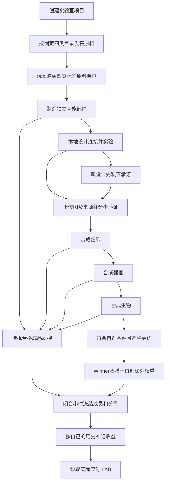

# 首版玩家流程

当前是可在本地运行并验收的数字功能生物实验室。原生协议、客户端和构造工作台分别
提供链上规则、交易操作和本地实验。尚未部署公网；下面描述已实现的首版流程。

默认使用玩家模式，左侧统一为协议数据、实验室项目、生物工坊、生物能、我的资产、交易市场、首创研究。
项目浏览与首次发售在「实验室项目」；设计、制造与合成在「生物工坊」；交易市场展开原料、成品、生物三类。
精确交易、技术编号和恢复工具保留在底部高级入口。主站保留十二个原业务页面，并增加三个市场说明页；正式市场尚未接入，显式本机模式下可另开测试账号体验。
导航与当前能力见[统一导航验收](PLAYER-NAVIGATION-ACCEPTANCE.md)。

“选择钱包”提供Phantom（幽灵钱包）、Solflare、Backpack及已发现的其他标准钱包。
未安装时可进入固定官网；可连接或登录不代表当前版本能签本项目交易，签名能力与网络仍须实际核对。
当前完成的是接口、HOST与离线浏览器验收，三品牌真实扩展和手机设备验收仍未执行。

构造画布可点选角色，再调整营养、氧气、废物连接、比例、位置与层级模式，不必手写整份JSON。
任一改动会撤销旧实验结果；高级JSON草稿须先应用，才可实验或交接。通过本地实验后可以带入合成目标，
仍需选择真实输入、导入设计、检查费用并完成原生验证。费用输入使用SOL/LAB正常单位，
不会暗中增大上限；类型4部件按功能用途名称选择。底层规则、材料消耗和奖励不变。

## 四类原料是什么

原料是 **AA、NUC、LIPID、SUGAR 四种不同类别的标准单位**，直接进入制造。
一个类别标准单位按固定目录给出其每个物种各 1,000 ticks 的使用预算；这只是材料
账本的精确计量，玩家不进行开包或兑换物种。目录、类别、换算及固定部件配方不可
由项目创建者改写。原料 Token 被实际销毁后，Source 审计账保留尚未使用的原始预算。

| 类别 | 固定目录 | 一单位的含义 |
| --- | --- | --- |
| AA | 20 种标准氨基酸 | 各物种 1,000 ticks |
| NUC | 4 种脱氧核苷三磷酸、ATP/CTP/GTP/UTP | 各物种 1,000 ticks |
| LIPID | DOPE、DOPG、DOPC | 各物种 1,000 ticks |
| SUGAR | D-glucose | 1,000 ticks |

这些名称不等于真实实验室中的物质量或真实代谢动力学。首版以固定功能原语和明确
连接规则验证作品；不能提交任意真实蛋白序列后要求系统证明其折叠或生物活性。

## 玩家能卖什么、得到什么

实验室项目注册该项目的四类原料币，使用同一个固定目录和全网额度。创建者确定
各类售价，协议固定资源费、全网季额和终身额度。购买原子完成付款、额度扣减、
原料交付和永久来源记录。自买自卖不会产生销量补贴、额外原料或 LAB。

项目销售收入与作品挖 LAB 是两笔不同的账。项目创建者不能创建第五类原料或增发
LAB；实际材料来源和原生权限也不能被网页上的名称、头像或项目包装替代。

## 从部件到生物

首版 F1 部件固定配方消耗 20 种氨基酸各 500 ticks、4 种脱氧核苷三磷酸各
500 ticks、ATP 1,000 ticks、3 种脂质各 250 ticks、葡萄糖 250 ticks。
其有效基数为 120 RU，制造退役为 45 RU。RU 是加权材料计量，不是另一个币。

玩家选择部件种类，并在允许的端口、容量和守恒规则内自由连接。上层作品继承
实际投入的下层实例与完整来源胶囊。系统验证结构，以及逐轮供能、物流、控制、
障碍恢复和机械任务；不是上传图就自动通过。

参考完整链实测使用四类标准单位 `[30,60,15,15]`，共 120：

| 阶段 | 实际投入与产出 | LAB 制造费 |
| --- | --- | --- |
| 基础制造 | 原料→60 个 F1 部件 | 无 LAB 制造费；另付实际网络和账户成本 |
| 细胞 | 60 个部件→15 个细胞 | 每个 0.8，共 12 |
| 器官 | 15 个细胞→6 个器官 | 3.2、4.8、6.4、3.2、3.2、3.2，共 24 |
| 生物 | 6 个器官→1 个生物 | 12 |
| 合计 | 82 个生成实例，81 个已投入合成 | 48 LAB 实际销毁 |

投入合成的旧实例永久消费，不能拆回、重新质押或和新成品同时计权。它们以前已经
赚取但尚未领取的收益仍归原受益人。材料账中没用过的预算继续属于原库存；这不是
拆解退款或回收。升级需要先退出相关输入并补清其实际历史覆盖。

## 持续产出怎样领取

部件、细胞、器官、生物都可在合格时登记质押。普通权重由实际材料基数、验证品质
和层级决定；上层合成提高层级系数。相同基数、品质和层级的两个设计，普通权重
相同；单纯降低首创任务成本 C 不额外提高普通产出。

每个闭合小时冻结真实成员、分母和有限预算。全局执行器推进小时；个人可独立补记
自己的旧账，再领取实际 accrued−paid。别人的旧账不会阻塞未来冻结。每小时金额
随全网权重、减半及本人资格变化，不能承诺固定日产量。

LAB 总量一亿、6 位小数，普通和首创奖励共享固定储备；制造费销毁已存在的 LAB。
未赚到的收益不能当制造费，提款也不重新铸币。作品转让后，旧 Position 的收益
仍付给旧受益人，代执行者不能改收款人。

本地同版完整原生执行中，部件实际赚取 48.083160 LAB，支付 48 LAB 合成费；
最终生物再领取两小时 0.941780 LAB，钱包合计 1.024940 LAB。这是已冻结条件下的
具体账例，不是公网收益保证、代币价格或普通玩家的 SOL 成本报价。

## 自由设计与首创

可复制参考作品参与普通持续产出。新作品先在本地实验，再以随机 salt、作者和
排定的最终制造 nonce 提交私有承诺，之后公开上传、验证、实际制造及披露。
承诺不是保留 nonce，额外作者操作会打乱原计划；不能悄悄替换已承诺的最终 nonce。

首创需要通过真实任务、资格和严格改进检查，并产生实际 Winner。本轮发现合法C310，
已按旧16模型前沿316完成真实本地首创及领奖。它现在已经公开，新的OPEN310开场在
16个必备模型之外加入C310，前沿为310；复制C310不能冒充新首创。尚未确认仍未公开
的合法C<310方案，也未证明310全局最优；首创额外奖励不保证每轮出现。

公网版本先明确签署站点登录消息，进入对应地址的工作流；登录不授权交易。切换
钱包或注销会清除旧计划和签名。每笔制造、质押或领取仍须单独检查和签名。当前
公网入口代码已经本地验收，真实域名、钱包及网络尚未接入。

无需已知ID时，可从“实验室发售目录”查找项目，再重读实际发售进入购买；
“我的BioLab资产”分开列出当前成品、旧受益权益、原料余额和Source。Source与合成
输入可跨同分类页选择有界ID集，交接后明确读取。扫描有覆盖限制，不能把已消费
祖先当成可用输入，也不能把历史摄入份数加回原料余额，详见[发现手册](DISCOVERY-OPERATIONS.md)。

运行入口和模块验收见 [README](../README.md)、[实施状态](IMPLEMENTATION-STATUS.md)
与 [原生客户端流程](../packages/client/SESSION.md)。后期生态世界、捕食和经验系统
尚未实现，也不参与首版 LAB 账本。
