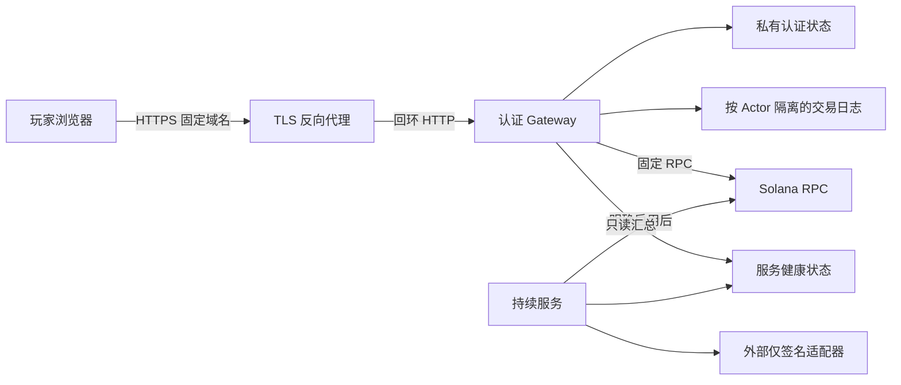

# 公网入口与持续服务运行规格

日期：2026-10-25。认证、权限、会话隔离和持续服务已实现并做本地验收。本文件是部署和运维规格；本次没有启动公网入口、接入真实钱包、花费真实资金或部署程序。独立安全审计按用户要求暂不安排。

## 进程和信任边界



`npm start`仍是本机工作台。公网入口使用`node apps/gateway/main.mjs --config /absolute/gateway.json`，CLI只监听127.0.0.1。部署时由单独TLS代理提供有效证书、固定域名、连接和流量限制。Node私有目录须持久化；不可放到无持久文件系统的静态站点托管中。

Gateway配置文件须为当前运行用户所有、普通单链接文件、0600权限，状态目录0700，路径使用绝对路径。以下只是字段模板，不是可用生产配置：

```json
{
  "publicOrigin":"https://YOUR-DOMAIN",
  "nativeConfigFile":"/absolute/private/native.json",
  "authStateDirectory":"/absolute/private/auth-state",
  "port":4319,
  "localPublicFixture":false,
  "trustedProxyClientIP":true,
  "serviceConfigFile":"/absolute/private/service.json"
}
```

`serviceConfigFile`可省略；它只开放登录后可读的健康汇总，不提供任何控制权限。`native.json`精确字段为`releaseFile`、`endpoint`、`stateDirectory`、`localPublicFixture`，其中endpoint只由运营配置选择，浏览器不得传RPC、发布文件或状态路径。Gateway与service必须引用同一个releaseFile和fixture模式，实际发布内容还须通过各自校验。

开启`trustedProxyClientIP`时，Gateway仅接受回环对端，代理必须**覆盖**`x-biolab-client-ip`为实际客户IP，不能透传用户自报值；否则应保持false，并接受代理共享速率桶。代理保留请求的真实Host和Origin，不能把任意Origin改写成可信站点。X-Forwarded-Host/Proto/For均不用于选择认证身份、站点或网络。部署防火墙不得把Node回环服务直接暴露出去。

## 登录与权限

钱包明确连接后，请求一次限时挑战，核对13行完整消息，再明确签署。服务端验证Ed25519签名并原子消费挑战；它绑定Origin、release、ABI、domain、config及Actor。登录不授权链上操作。会话默认30分钟，最多1小时；挑战默认120秒，最多300秒。实际交易仍须原有精确准备、检查、模拟、签名和发送步骤。

生产Cookie为`__Host-biolab_session`，HttpOnly、Secure、SameSite=Strict、Path=/且无Domain。状态只保存随机token的哈希。注销、替换登录和过期均使旧会话失效；重启不会复活已撤销token。客户端内存只保存公开Actor和发布上下文；切换账户、注销或跨标签失效会清除七个控制器的草案、旧读数和签名。迟到配置不能重新打开已失效身份的操作。

所有native POST在业务操作之前要求会话Actor与请求主体一致。不同Actor的耐久日志和制造/研究清单分开；同一Actor的多个会话复用同一nonce历史。共签者仅能检查/模拟其确为必要签名人的规范信封，不能取得主体日志控制权。研究进度仅允许作者及不可变清单命名的推进者读取，推进者不能COMMIT、FINAL、领奖或消费作者资产。服务器仍核对实际交易签名，Cookie不能代替签名。

POST要求精确Origin、JSON及大小上限；Host、跨站、查询参数、并发、速率及HTTP时限均有界。错误不返回私有目录、盐、Cookie或原始内部错误。固定策略见[检查表](../apps/gateway/PUBLIC-CHECKLIST.md)、[认证规格](../packages/bridge/PUBLIC-AUTH-CHECKLIST.md)及[页面认证规格](../apps/player/AUTH-CHECKLIST.md)。

## 持续服务

详见[完整Service运行手册](../apps/service/RUNBOOK.md)。先以`sendEnabled:false`启动，`tick`执行一次，`run --ticks 100 --duration-ms 300000`是有界持续循环；实际长期运行由运营进程管理器重启并监控。默认不寻找或加载任何私钥文件。

自动发送须在配置中明确启用，并显式提供`--adapter /absolute/adapter.mjs`。外部适配器只签精确信封，不能广播；服务独立执行模拟、实际v1费用和租存报价、余额以及单步/每日/终身预算检查。报价不可用、签名器离线、余额不足或预算满时WAIT，不猜报价、不补发奖励。保守费用预留跨重启保留，失败或UNKNOWN也不恢复额度；它不是实际费用收据。

全局服务仅推进冻结的六类小时/事件操作；玩家领取和转让仍是玩家流程。研究任务只允许指定推进者的VERIFY_STEP。未决交易只核对原Frame，不能跳nonce；只有finalized高度超过有效期且旧hash无效后才允许有界刷新。中断SIGNING、取消获胜、死进程lease等均有明确的本机恢复命令，不按年龄自动抢锁。STOP文件和SIGINT/SIGTERM停止后续签名/提交；进行中的调用有取消和超时边界。

`status`是本机运营输出，含公开角色和工作流名称，不能原样公网返回。登录后`GET /api/service/status`只返回有界计数、模式和RUNNING/STOPPED/OWNER_DEAD/UNKNOWN；无地址、路径、PID、token、私有图或签名。RUNNING要求当前同机活进程及新鲜持久心跳，`/healthz`只证明Gateway自身能回应。服务健康接口不提供HTTP签名、支付、停止或恢复操作。

## 备份与恢复验收

备份整份认证、Actor日志、服务预算和lease状态，保留文件权限与发布身份；恢复前停止对应进程并核对上下文。不能删除nonce日志、已花费用或历史债权来解除WAIT。数据不明时保持UNKNOWN，核对链上实际记录及外部签名适配器，再使用原请求恢复。恢复旧认证快照可能复活旧会话，故生产灾备切换须撤销旧认证状态并要求重新登录，不能把旧token快照当成可继续的会话。

本地已验收实际HTTP、临时证书TLS代理、挑战重放、跨Actor、共签权限、并发登录、会话撤销/重启、迟到响应、费用/lease/签名器故障与健康脱敏。真实目标钱包、RPC v1报价/模拟/finality、域名证书、服务器与外部签名器、持续负载、监控和真实费用仍须在选定环境中验收。源码具备这些接口，不表示这些环境已经存在。

认证依据：[Solana消息认证](https://solana.com/docs/frontend/messages-and-auth)、[OWASP会话](https://cheatsheetseries.owasp.org/cheatsheets/Session_Management_Cheat_Sheet.html)、[OWASP CSRF](https://cheatsheetseries.owasp.org/cheatsheets/Cross-Site_Request_Forgery_Prevention_Cheat_Sheet.html)、[Node HTTP时限](https://nodejs.org/api/http.html)。
